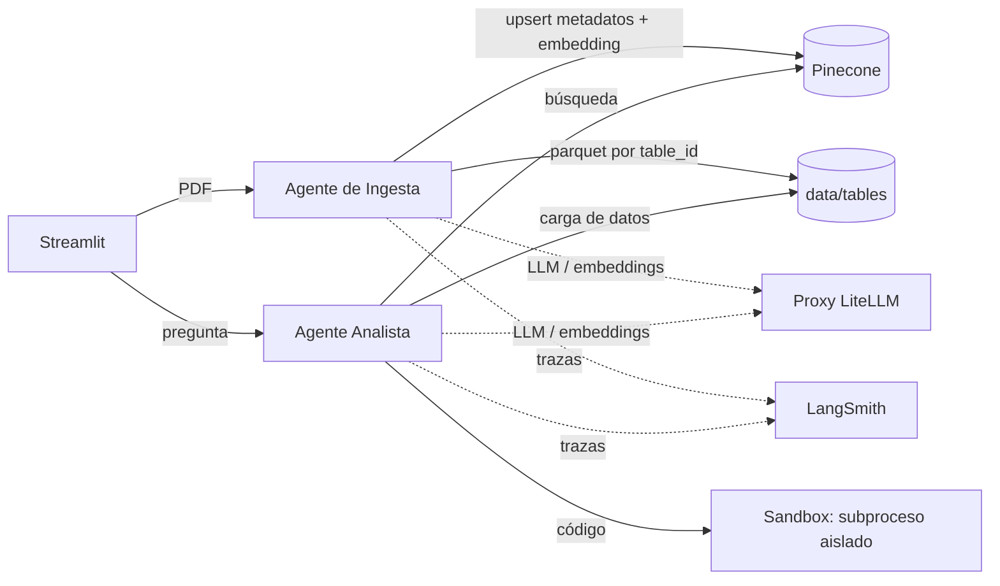
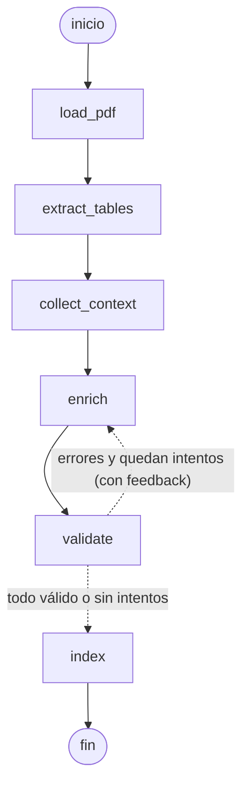
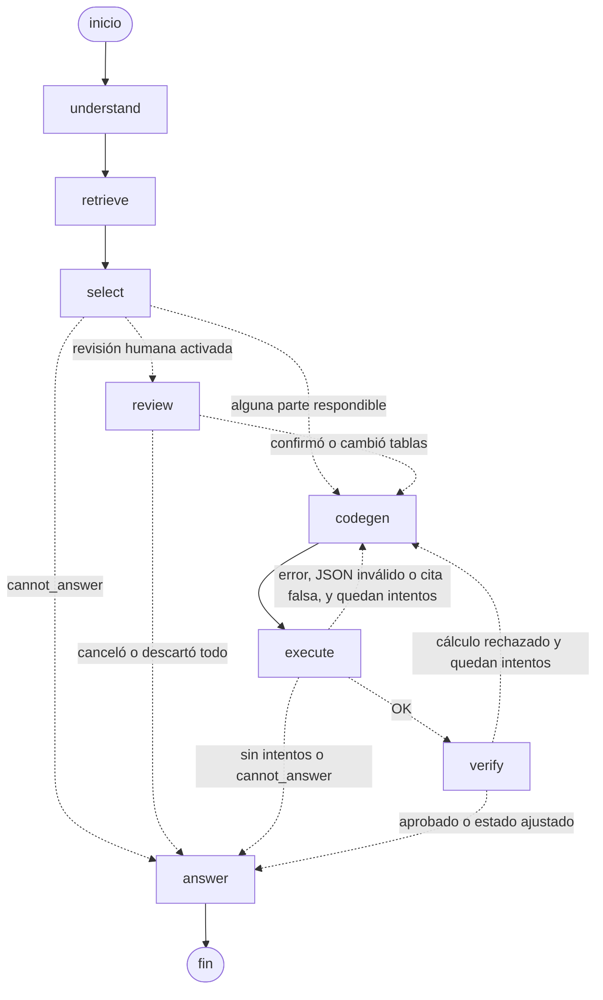

# QA multiagente sobre tablas en PDFs

Dos agentes en LangGraph sobre una UI de Streamlit:

1. **Agente de Ingesta:** recibe un PDF, extrae sus tablas, infiere sus metadatos (nombre, descripción, columnas, encabezados de fila) a partir del contexto con un LLM, y las indexa en Pinecone.
2. **Agente Analista:** recibe una pregunta, recupera y selecciona las tablas necesarias, escribe un programa Python que calcula la respuesta, lo ejecuta en un sandbox, se autocorrige si falla y responde con estado `answered` / `partial` / `cannot_answer`.

Adentro del Analista trabaja un tercer agente, el **verificador**, que no resuelve nada: revisa el programa que se ejecutó contra las reglas de respondibilidad antes de que se redacte la respuesta. Además, cada número de la respuesta viene con **las celdas de las que salió**, verificadas en código contra los datos. Ver [Distintivos](#distintivos).

Todas las llamadas a LLM y embeddings pasan por el proxy LiteLLM de la universidad, y cada ejecución queda trazada en LangSmith.

**Video demo:** *link pendiente*

## Instalación

Requiere Python 3.11+ (probado con 3.12) y [uv](https://docs.astral.sh/uv/).

```bash
uv venv --python 3.12 .venv
source .venv/bin/activate
uv pip install -r requirements.txt
cp .env.example .env
```

Completar el `.env`:

| Variable | Uso |
|---|---|
| `LLM_SERVICE_URL`, `LLM_API_KEY` | URL y clave del proxy LiteLLM. También se aceptan los nombres del enunciado, `LITELLM_BASE_URL` y `LITELLM_API_KEY`. |
| `LLM_MODEL` | Modelo principal (usamos `gpt-4.1`): selección de tablas, código y verificación. |
| `LLM_MODEL_FAST` | Opcional. Modelo rápido (usamos `gpt-4.1-mini`) para interpretar la pregunta y redactar la respuesta. Si falta, se usa `LLM_MODEL`. |
| `EMBEDDING_MODEL` | Modelo de embeddings (`text-embedding-3-small`, dimensión 1536). |
| `PINECONE_API_KEY`, `PINECONE_INDEX_NAME` | Índice serverless, dimensión 1536, métrica cosine. |
| `LANGSMITH_TRACING=true`, `LANGSMITH_API_KEY`, `LANGSMITH_PROJECT` | Trazas. |

## Ejecución

```bash
streamlit run app.py                                         # UI: subir, explorar, preguntar
python -m agents.ingestion data/sample_pdfs/*.pdf            # ingesta por línea de comandos
python -m agents.analyst "¿Cuánto crecieron las ventas de la región Sur en 2024?"
python scripts/run_eval.py                                   # corre las 11 preguntas de prueba
python scripts/run_eval.py --repeats 3                       # cada pregunta 3 veces (mide la variación)
python scripts/langsmith_eval.py --repeats 3                 # dataset + experimento en LangSmith
python scripts/check_env.py                                  # chequeo rápido del proxy, embeddings y Pinecone
pytest                                                       # tests (sin llamadas reales)
```

Para regenerar los PDFs de ejemplo: `python scripts/generate_sample_pdfs.py`. El extractor y los tests dependen de estos PDFs.

## Estructura

```
app.py                  punto de entrada de Streamlit
ui/                     una pestaña por módulo (ingest_tab, explore_tab, ask_tab) + widgets
agents/ingestion/       grafo, nodos, prompts, schemas, validación, armado de registros
agents/analyst/         grafo, nodos, prompts, schemas, lógica determinística (estado, citas,
                        verificador, revisión humana) y recuperación híbrida (retrieval.py)
evaluation/             casos de prueba con tablas esperadas y métricas por etapa
services/               extracción de PDF, contexto, LLM, Pinecone, almacén de tablas, sandbox
data/sample_pdfs/       PDFs de la demo
data/preguntas_prueba.md  preguntas de prueba con estado y respuesta esperados
data/tables/            parquet generados por la ingesta (no versionado)
scripts/                generación de PDFs, evaluación (local y LangSmith) y chequeo del entorno
notebooks/              notebooks y apuntes de las clases (no forman parte del sistema)
tests/                  pytest, con dobles del LLM, los embeddings y Pinecone
EVALUATION.md           informe de evaluación
```

## Arquitectura



### Grafo de ingesta



| Nodo | Qué hace |
|---|---|
| `load_pdf` | Abre el PDF y conserva el texto de cada página. |
| `extract_tables` | `services/pdf_extract.py`, **sin LLM**: `find_tables()`, aplana encabezados de dos filas, une tablas multipágina, convierte números es-AR (`($ 41.200)`, `7,2 %`, `US$ 3.420,5`, `4.812,3`) a `float`, deja las celdas vacías como nulos e informa en `skipped` las tablas que no se pueden leer (p. ej. una imagen). |
| `collect_context` | Para cada tabla: título de sección, párrafo y rótulo de arriba; nota o fuente de abajo (en una tabla multipágina, la de la última página). |
| `enrich` | `with_structured_output(TableMetadata)`: nombre, descripción de 2–4 oraciones, unidad, período, columnas (descripción, tipo, unidad) y encabezados de fila. Las tablas van en lote; en un reintento solo vuelven las que fallaron, con el error de validación en el prompt. |
| `validate` | Código puro: misma cantidad de columnas, cada nombre existe en el DataFrame, ninguna columna sin cubrir, y los encabezados de fila existen y no se repiten. Hasta 3 intentos; si se agotan, la tabla se saltea y se informa (nunca se indexan metadatos inválidos). |
| `index` | `table_id` = sha1 de archivo, página inicial e índice de la tabla. Guarda `data/tables/{table_id}.parquet`, embebe nombre + descripción + columnas + encabezados de fila y hace upsert con los metadatos, `source` (archivo y páginas) y una vista previa de 5 filas. Borra los vectores de una ingesta anterior del mismo archivo que ya no corresponden. |

### Grafo del Analista



Los tres ciclos (`execute → codegen`, `verify → codegen` y el de las citas) comparten el mismo límite de 3 intentos de código.

| Nodo | Modelo | Qué hace |
|---|---|---|
| `understand` | rápido | Salida estructurada `QueryPlan`: la **pregunta autocontenida** (resuelve "¿y en 2023?" con la memoria de la conversación), entidades, métricas, períodos, operaciones, consulta reescrita para la búsqueda y **partes** de la pregunta (p. ej. "qué región" / "por cuánto superó al promedio nacional"). |
| `retrieve` | — | **Híbrido:** top-10 semántico en Pinecone + BM25 sobre los metadatos de todas las tablas, fusionados con Reciprocal Rank Fusion; quedan 5 candidatas. Los tres rankings quedan en el estado y se ven en la UI. |
| `select` | principal | El LLM decide, por parte, si es respondible y con qué tablas, columnas y filas (`Selection`), siguiendo las reglas de respondibilidad del enunciado con ejemplos negativos. Después, **`check_selection` verifica en código contra el parquet** que esas columnas y filas existan: si el LLM pide la columna `2020` y la tabla cubre 2021–2023, la parte pasa a no respondible. El **estado se calcula en código**: todas respondibles → `answered`; algunas → `partial`; ninguna → `cannot_answer`. |
| `review` | humano | Solo si el usuario activó la revisión: `interrupt()` pausa el grafo y la UI muestra las tablas elegidas por parte. El usuario confirma, cambia las tablas o cancela, y el grafo sigue con `Command(resume=...)`. Una parte que se queda sin tablas pasa a no respondible. |
| `codegen` | principal | Salida estructurada `GeneratedCode`. El prompt lleva los nombres exactos de columnas, dtypes y las primeras filas de cada tabla, la lista de partes a calcular y la de partes que **no** debe calcular. El programa tiene que devolver, por parte, el resultado, la unidad, la explicación y **las celdas que usó**, y guardar un gráfico si el resultado es una serie. En un reintento recibe el código anterior y el error (de ejecución, de las citas o del verificador). |
| `execute` | — | Corre el código en el sandbox, parsea la última línea JSON del stdout y la valida (están todas las partes, sin NaN). Después **verifica cada celda citada contra el parquet** (tabla, fila, columna y valor): una cita que no existe o con otro valor es un error y el código se reescribe. Si el código informa un dato faltante, esa parte baja de estado. Si se agotan los intentos, las partes pendientes quedan como no respondibles. |
| `verify` | principal | **Agente verificador**: recibe las partes, las tablas, el código y el resultado, y devuelve un `Verdict` con violaciones de tipo `calculo` (aproxima un dato que falta, usa otro año, inventa una constante, calcula una parte no respondible) o `dato_faltante`. El código aplica el veredicto: `calculo` vuelve a `codegen` con el detalle; `dato_faltante` baja la parte a no respondible y recalcula el estado. |
| `answer` | rápido | Redacta la respuesta con los resultados, las tablas y páginas usadas y el cálculo. No cambia el estado; en `cannot_answer` explica qué falta y qué cubre la tabla relacionada, sin números. Agrega el turno a la memoria de la conversación. |

El estado del grafo (`status`, `missing_data`, `selection`, `citations`, `verdict`, `code`, `code_attempts`, `history`, etc.) se puede testear: ver `tests/test_analyst.py` y `tests/test_analyst_distintivos.py`.

## Distintivos

Más allá de lo obligatorio, el sistema suma cosas vistas en la materia y una que no está en la consigna.

| Distintivo | Clase | Dónde | Por qué |
|---|---|---|---|
| **Agente verificador** | Prompting (agente que solo evalúa), Razonamiento ("articulado, pero equivocado") | `nodes.verify`, `logic.apply_verdict` | `check_selection` verifica que existan las columnas, pero no puede ver la lógica del código. En la primera versión, el código de la pregunta 7 promediaba las regiones para inventar un "promedio nacional" aunque el estado era `partial`. El verificador está para ese tipo de error. |
| **Citas a nivel de celda, verificadas en código** (fuera de la consigna) | RAG ("tener citas no es estar grounded; las citas hay que verificarlas"), Memoria (procedencia) | `logic.check_citations`, pestaña Preguntar | Cada número de la respuesta trae las celdas de las que salió, y el sistema comprueba que existan con ese valor en el parquet. Una cita falsa no se muestra: el código se reescribe. El usuario ve una tabla con cada celda usada y su verificación. |
| **Recuperación híbrida (BM25 + RRF)** | RAG (hybrid retrieval, Reciprocal Rank Fusion) | `agents/analyst/retrieval.py` | Los embeddings captan paráfrasis; BM25 premia términos exactos como años, regiones o "I+D". RRF combina los dos rankings sin calibrar puntajes. |
| **Memoria de la conversación** | Memoria (episódica × buffer × hilo) | `state.history`, checkpointer, `understand` | Permite repreguntar ("¿y en 2023?"). Alcance: la conversación (`thread_id`); ventana: 3 turnos; TTL: la sesión. Se guarda la pregunta interpretada, las tablas y el estado, no los números, para no arrastrar resultados viejos. Es memoria, no conocimiento: la verdad compartida son las tablas. |
| **Revisión humana** (bonus) | Tools / agentes | `nodes.review`, formulario en la UI | `interrupt()` antes de generar código: el usuario confirma o cambia las tablas. |
| **Gráfico** (bonus) | — | sandbox + `codegen` | Si el resultado es una serie, el programa guarda `chart.png` con matplotlib dentro del sandbox y la UI lo muestra. |
| **Evaluación por etapas, repetida y en LangSmith** (bonus) | RAG ("respuesta incorrecta ≠ falla del LLM"), Usar los modelos (evaluar antes de escalar) | `evaluation/`, `scripts/run_eval.py`, `scripts/langsmith_eval.py` | Mide por separado recuperación, selección, estado y valores, y corre cada pregunta varias veces para medir la variación en lugar de reportar una corrida. |
| **Ruteo de modelos por rol** | Usar los modelos (task–model fit) | `services/llm.py`, `AnalystDeps.llm_fast` | El modelo chico interpreta y redacta; el grande selecciona, programa y verifica, que es donde un error es caro. |

## Decisiones de diseño

- **Extracción con PyMuPDF.** No necesita Java ni Ghostscript, y da a la vez las tablas (`find_tables()`) y los bloques de texto con sus coordenadas, que se usan para el contexto. La extracción es determinística: el LLM solo interviene en el enriquecimiento.
- **Unión de tablas multipágina.** Una tabla se une con la anterior si es la primera de su página, la anterior terminó en la página previa, tienen la misma cantidad de columnas, el encabezado se repite o falta, y **no tiene rótulo propio** ("Cuadro N"). La condición del rótulo evita unir tablas distintas con el mismo encabezado en páginas consecutivas (en el anuario, los Cuadros 2.1 y 3.1 tienen ambos `Región, 2021, 2022, 2023`).
- **Números.** Se asume formato es-AR (punto de miles y coma decimal). Una columna se convierte a número solo si todos sus valores son numéricos; las columnas de años (`Año`) quedan como texto porque son una dimensión.
- **Almacén de tablas: un parquet por `table_id`** en `data/tables/`. Los metadatos de Pinecone tienen un límite de unos 40 KB por registro, así que los datos completos no van ahí: Pinecone guarda los metadatos, una vista previa de 5 filas y la ruta del parquet. Parquet conserva los tipos (float / texto) que deja el extractor.
- **Embeddings: un vector por tabla**, armado con nombre + descripción + unidad + período + columnas (con descripción y unidad) + encabezados de fila. No se hace chunking: una tabla es la unidad de recuperación y su descripción entra holgada en un embedding.
- **Idempotencia.** El `table_id` es determinístico, así que reingerir el mismo PDF sobrescribe los mismos registros. Si una tabla desaparece entre ingestas, se borra su vector: se buscan los ids del archivo con una consulta filtrada por metadatos, porque Pinecone serverless no borra por filtro.
- **El estado de respondibilidad lo decide el código.** El LLM propone la selección, pero el estado sale de `compute_status` sobre la selección ya verificada contra los datos, y puede bajar después de la ejecución. La redacción final no lo cambia.
- **Sandbox** (`services/sandbox.py`):
  - **Proceso aislado:** subproceso aparte (`python -I`), con timeout de 20 s y límite de CPU.
  - **Directorio y entorno:** corre en un directorio temporal que solo contiene los parquet seleccionados, y con un entorno vacío, así que no ve las API keys.
  - **Audit hook (PEP 578):** bloquea red, creación de procesos, `ctypes` y la lectura o escritura de archivos fuera del directorio de trabajo y de la instalación de Python.
  - **Tests:** hay tests para cada caso, incluido el gráfico.
- **Memoria y revisión humana con un checkpointer.** La UI compila el Analista con un `InMemorySaver` y usa un `thread_id` por conversación. El mismo mecanismo sirve para la memoria (`history` con un reducer que acumula turnos) y para pausar y reanudar la revisión humana. Es memoria del proceso: se pierde al reiniciar Streamlit, lo que coincide con el alcance elegido (la sesión). La CLI y la evaluación corren sin checkpointer, así que cada pregunta es independiente.
- **Citas verificadas en código, no por el LLM.** Que el programa cite celdas no prueba nada si nadie las mira. Por eso la verificación es determinística (tabla, fila, columna, valor con tolerancia de redondeo) y una cita falsa cuenta como error de ejecución.
- **Nombres de variables del proxy.** Se usan los nombres del proxy de la materia (`LLM_SERVICE_URL`, `LLM_API_KEY`) y también se aceptan los del enunciado.
- **Inyección de dependencias.** Los nodos reciben el LLM, los embeddings y el índice por `IngestionDeps` y `AnalystDeps`. Así los tests usan dobles y no gastan presupuesto del proxy.

## Observabilidad

Con `LANGSMITH_TRACING=true`, cada ejecución se registra con:

- **Nombre:** `ingesta:<archivo>` o `analista: <pregunta>`.
- **Tags:** `ingestion` o `analyst`.
- **Metadatos:** el archivo o la pregunta, y el `thread_id` de la conversación en la UI.

Las preguntas de una misma conversación comparten `thread_id`, así que en LangSmith se pueden filtrar juntas.

Cada nodo del grafo es un span, y adentro se ven las llamadas al LLM con sus prompts y salidas estructuradas. Hay tres trazas representativas en [EVALUATION.md](EVALUATION.md).

## Evaluación

Las 11 preguntas de [`data/preguntas_prueba.md`](data/preguntas_prueba.md) se evalúan por etapa (recuperación, selección, estado y valores) y con varias corridas por pregunta. El informe completo, con el historial de corridas que fallaron, está en [EVALUATION.md](EVALUATION.md).

## Limitaciones conocidas

- **Continuaciones rotuladas.** Si un PDF rotula también la continuación ("Cuadro 3 (cont.)"), la segunda parte tiene rótulo propio y **no se une**. Habría que reconocer el sufijo "(cont.)" o comparar el número de cuadro con el de la tabla anterior.
- **Formato de los rótulos.** Se detectan con el patrón `Cuadro N.`; otros formatos ("Tabla 3") no se asocian. Una tabla sin rótulo se indexa igual, con el nombre que infiere el LLM.
- **Detección de tablas.** Depende de `find_tables()`: funciona bien con tablas con bordes; las tablas sin líneas o con diseños complejos pueden detectarse mal.
- **Sin OCR.** Las tablas en imagen se saltean y se informan.
- **Formato numérico.** Se asume es-AR; un PDF con formato en-US (`1,234.5`) se convertiría mal.
- **El sandbox no es un contenedor.** Las extensiones nativas (p. ej. pyarrow) pueden abrir archivos sin pasar por el audit hook. Para producción haría falta un contenedor o un microVM sin red.
- **Recuperación.** El top-k final es fijo (5) y no hay reranking con un modelo. BM25 se calcula sobre todo el catálogo en cada pregunta (se leen los metadatos de Pinecone): con pocas tablas es instantáneo, con miles habría que mantener un índice léxico aparte.
- **El verificador también es un LLM.** Puede dejar pasar un error o marcar uno que no existe (un falso positivo cuesta un reintento). Por eso no decide el estado solo: sus violaciones se aplican con reglas en código, y las comprobaciones que se pueden hacer sin LLM (columnas, filas, citas) se hacen sin LLM.
- **Citas de agregados largos.** Si el cálculo usa una columna entera, el programa cita todas sus celdas; con tablas muy largas eso agranda la salida.
- **Memoria en un solo proceso.** El checkpointer vive en memoria: dos réplicas de la app no comparten conversaciones y un reinicio las borra. En producción iría un checkpointer persistente (SQLite o Postgres).
- **No determinismo del LLM.** Aun con temperatura 0, la selección y el código pueden variar entre corridas (ver [EVALUATION.md](EVALUATION.md)).

## Créditos

- **Bruno Enzo Baumgart:** autor del TP. Diseñó el sistema, tomó las decisiones de arquitectura y de alcance, orquestó el trabajo con los asistentes de IA, revisó cada cambio y lo probó contra el proxy, Pinecone y LangSmith reales.
- **Claude (Anthropic):** planificación del trabajo, generación de los PDFs de ejemplo y de las preguntas de prueba con sus respuestas, revisión del código y los distintivos del Analista (verificador, citas por celda, recuperación híbrida, memoria, revisión humana, gráfico, ruteo de modelos y evaluación por etapas).
- **Cursor:** asistencia de IA durante el desarrollo del extractor, los grafos, el sandbox y la UI.

Los PDFs de ejemplo son ficticios y se generan con `scripts/generate_sample_pdfs.py` (reportlab).
